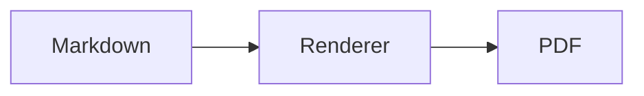

# pi-md2pdf

**Export Markdown to PDF directly from [Pi Coding Agent](https://pi.dev/).**

Convert reports, specifications, technical notes and other Markdown documents to GitHub-style PDFs, without leaving Pi. Supports LaTeX equations, Mermaid diagrams, syntax-highlighted code, tables, local images, clickable links and optional tables of contents.

Everything renders locally using your existing Chrome, Chromium or Edge browser. No document uploads, external rendering services or additional browser installation.

> **Release status:** v0.1.0 is being prepared for its first npm publication. The installation command below will work once the package is published. Linux/Chromium has been tested; native Windows and macOS runtime verification remains pending.

## Installation

Requirements:

- Pi Coding Agent.
- Node.js 22.19 or later.
- Chrome, Chromium or Microsoft Edge installed and usable in headless mode.

~~~sh
pi install npm:pi-md2pdf
~~~

Restart Pi to load the extension.

## Usage in Pi

### Direct command

~~~text
/md2pdf report.md
~~~

The PDF is created alongside the Markdown file. To specify an output filename or override settings:

~~~text
/md2pdf "Monthly Report.md" "Monthly Report.pdf"
/md2pdf report.md --output custom-report.pdf
/md2pdf report.md --toc --number-sections
/md2pdf report.md --paper letter
/md2pdf --help
~~~

Use Tab to complete Markdown filenames, directories, command options and option values. The slash command runs directly without a model call.

### Ask the agent

You can also ask Pi in natural language, for example:

- "Convert report.md to PDF."
- "Export docs/specification.md with a table of contents."
- "Convert report.md to PDF and preserve the existing heading numbering."

**Pi exposes the `markdown_to_pdf` tool for agent-driven conversions.** The tool resolves input and output paths within the current project directory, never searches other projects for matching filenames, and reports the actual generated PDF path and any Mermaid warnings. Expand the tool result for details.

For an explicitly chosen file outside the project directory, use the direct `/md2pdf` command with its absolute path.

## Settings

~~~text
/md2pdf settings
~~~

Use Up/Down to select a setting, Enter/Space to change its value, and Escape to close the menu. Changes are saved automatically and apply to future slash commands and agent conversions. **Reset to defaults** restores the original settings.

| Setting | Choices | Default |
| --- | --- | --- |
| Paper format | a4, letter | a4 |
| Table of contents | false, true | false |
| Number sections | false, true | false |
| Mermaid errors | `placeholder`, `source`, `strict` | `placeholder` |

### Mermaid error modes

What happens if a diagram cannot be rendered:

- **`placeholder` (default):** Insert an error message with the source line number and the original Mermaid code as a literal code block. Continue generating the PDF.
- **`source`:** Insert only the original Mermaid code as a literal code block, without an error message in the PDF. Continue generating the PDF.
- **`strict`:** Abort conversion at the first diagram error. No new PDF is generated.

Both continuing modes report failed diagram counts and source line numbers in the conversion result. Browser failures, timeouts, cancellation, filesystem errors and resource-limit violations remain fatal in all modes.

Settings are stored in `~/.pi/agent/md2pdf/settings.json` (or under your configured Pi agent directory). No restart is required after changing them.

### Per-conversion options

Explicit options override saved settings for a single conversion without changing your preferences.

| Option | Description |
| --- | --- |
| `--output PATH` | Choose an explicit PDF filename; a second positional filename also works. |
| `--paper a4\|letter` | Set paper size. |
| `--toc` / `--no-toc` | Enable / disable a clickable table of contents (no printed page numbers). |
| `--number-sections` / `--no-number-sections` | Enable / disable automatic heading numbering; existing author numbering is preserved. |
| `--mermaid-errors placeholder\|source\|strict` | Select the diagram error mode. |
| `--browser-path PATH` | Select an installed browser executable. |
| `--force` | Explicitly authorize overwriting the requested output file. |
| `--help` | Show command help. |

For example, to export a document as-is even if automatic formatting is enabled in your settings:

~~~text
/md2pdf report.md --no-toc --no-number-sections
~~~

### Output filenames

If no output is specified, existing PDFs are never overwritten. A free filename is chosen automatically:

~~~text
report.md → report.pdf → report-2.pdf → report-3.pdf
~~~

With an explicit output filename, Pi asks before overwriting an existing PDF unless you supply `--force`. Agent calls require explicit overwrite authorization. Overwrite consent is never stored as a preference.

## LaTeX math

Write mathematical notation directly in Markdown. [KaTeX](https://katex.org/) renders equations locally, with its fonts embedded in the document. No TeX distribution is required.

Inline math uses `$...$` or `\(...\)`; display math uses `$$...$$`, `\[...\]`, or a fenced `math` / `latex` block.

~~~markdown
The energy is $E = mc^2$.

$$
\int_0^1 x^2\,dx = \frac{1}{3}
$$
~~~

Display example:

$$
\int_0^1 x^2\,dx = \frac{1}{3}
$$

Fractions, matrices, integrals, Greek letters, aligned equations and other KaTeX-supported math notation can be combined with normal Markdown, including table cells and headings.

**[LaTeX math guide](docs/LATEX.md)** — syntax examples, supported delimiters, literal code, multiline equations, PDF layout tips and limitations.

## Mermaid diagrams

Include flowcharts, sequence diagrams, class diagrams, entity relationships, state diagrams, Gantt charts and pie charts directly in Markdown.

~~~markdown

~~~

Mermaid diagrams render locally into validated, static SVG images in a separate Chromium context. The PDF-rendering page remains JavaScript-disabled. Diagram titles, built-in themes and selected visual settings are supported. HTML labels, interactive diagram links, external resources and arbitrary configuration overrides are restricted.

If a diagram fails, the configured [Mermaid error mode](#mermaid-error-modes) determines whether to preserve its source or abort.

**[Mermaid diagram guide](docs/MERMAID.md)** — diagram examples, configuration reference, error handling, compatibility restrictions and print-layout guidance.

## PDF appearance and privacy

The PDF uses the light [GitHub Markdown CSS](https://github.com/sindresorhus/github-markdown-css) theme with 10 mm margins, natural-width tables and print styling. A4 is the default. Fonts and pagination depend on the installed browser and system fonts.

Local PNG, JPEG and WebP images are supported when referenced beneath the Markdown file's directory. External resources are blocked and raw HTML in Markdown is escaped. The converter starts and closes Chromium on demand; documents are not sent to any external service.

Browser auto-detection:

| Platform | Search order |
| --- | --- |
| Linux | Chromium, Chrome, Edge |
| Windows | Edge, Chrome, Chromium |
| macOS | Chrome, Edge, Chromium |

Use the `MD2PDF_BROWSER_PATH` environment variable or `--browser-path` to select another compatible browser. Native Windows and macOS runtime testing is still pending.

## Update and uninstall

After publication:

~~~sh
pi update --extensions
pi remove npm:pi-md2pdf
~~~

## Development and contributions

See the [testing guide](https://github.com/civcode/pi-md2pdf/blob/main/docs/TESTING.md), [release checklist](https://github.com/civcode/pi-md2pdf/blob/main/docs/RELEASE.md), and [changelog](CHANGELOG.md). Report problems through [GitHub issues](https://github.com/civcode/pi-md2pdf/issues).

Build and test from a source checkout:

~~~sh
npm ci
npm run typecheck
npm test
npm run build
npm run check:load
npm run check:package
npm run pack:check
pi --extension ./dist/extension.js
~~~

The package checks use Pi's real extension loader and a clean temporary npm installation with a real headless browser. They do not publish anything.

Licensed under [MIT](LICENSE). See [third-party notices](THIRD_PARTY_NOTICES.md).

## Standalone CLI (optional)

You can use the same converter outside Pi. After npm publication:

~~~sh
npm install -g pi-md2pdf
md2pdf report.md
md2pdf report.md -o report-with-toc.pdf --toc --number-sections
md2pdf report.md --paper letter
md2pdf report.md --mermaid-errors strict
md2pdf --check
md2pdf --help
~~~

The CLI uses the same renderer and conversion options, but does not read Pi's saved preferences. It defaults to A4, no table of contents, no additional heading numbering and the `placeholder` Mermaid error mode.

Use `-o` or `--output` to specify the output path (Pi's slash command uses `--output` or a positional filename). The CLI refuses an occupied explicit output unless `--force` is provided. `--check` verifies headless browser PDF rendering; `--version` prints the package version.
