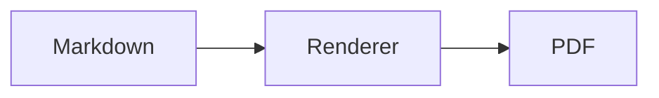

# pi-md2pdf

**GitHub-style Markdown → PDF**, for Pi Coding Agent and any terminal. One shared TypeScript renderer, two entry points, and an existing headless Chrome/Chromium/Edge browser. No browser download, GUI or network upload.

> **v0.1.0 release candidate — not yet published.** Linux builds, tests, Pi loading, and packed-package PDF rendering have passed; native Windows and macOS remain unverified. See the [release checklist](docs/RELEASE.md), [changelog](CHANGELOG.md), [compatibility matrix](docs/COMPATIBILITY.md), and [specification](docs/SPECIFICATION.md).

## Requirements

- Node.js 22.19 or later.
- Google Chrome, Chromium, or Microsoft Edge installed and usable in headless mode.
- For Pi integration, a current installation of [Pi Coding Agent](https://pi.dev/).

Browser selection defaults to **Edge → Chrome → Chromium** on Windows, **Chromium → Chrome → Edge** on Linux, and **Chrome → Edge → Chromium** on macOS. Set `MD2PDF_BROWSER_PATH` to use a custom executable.

## Usage

After public npm publication (not available yet):

~~~sh
npm install -g pi-md2pdf
md2pdf report.md
md2pdf report.md -o report-with-toc.pdf --toc --number-sections
md2pdf report.md --paper letter
md2pdf --check
~~~

For Pi after publication:

~~~sh
pi install npm:pi-md2pdf
~~~

In Pi:

~~~text
/md2pdf report.md
/md2pdf "Monthly Report.md" "Monthly Report.pdf" --toc
/md2pdf report.md --output custom-report.pdf
/md2pdf report.md --toc --number-sections --paper a4
~~~

Pi also exposes the `markdown_to_pdf` tool for agent-driven conversions. The slash command does **not** require a model call.

### Pi settings menu

Run `/md2pdf settings` in interactive Pi to open the native terminal settings overlay. Use the arrow keys to select a setting, Enter or Space to cycle its value, and **Save and close** to apply changes. **Reset to defaults** stages factory values; Escape discards unsaved edits.

| Setting | Choices | Factory default |
|---|---|---|
| Paper format | a4, letter | a4 |
| Table of contents | false, true | false |
| Number sections | false, true | false |
| Mermaid errors | placeholder, source, strict | placeholder |

Preferences are saved atomically to `<agentDir>/md2pdf/settings.json` (normally `~/.pi/agent/md2pdf/settings.json`, honoring `PI_CODING_AGENT_DIR`). Both the slash command and agent tool read saved preferences for each conversion; no restart is required after saving. The standalone CLI keeps its factory defaults. Explicit arguments override saved settings, including `--no-toc` and `--no-number-sections` or the agent tool's explicit false values. Overwrite consent, output paths and security restrictions are never saved as preferences. The settings menu does not make model calls.

### Pi slash-command completion and agent tool display

The interactive `/md2pdf` command provides **context-aware argument completion**.
Type the beginning of a local Markdown filename or option and use Pi's
completion key (typically **Tab**) to select a suggestion:

~~~text
/md2pdf rep                  # Complete a .md/.markdown file in Pi's cwd
/md2pdf docs/rep             # Complete inside a local subdirectory
/md2pdf "My Re               # Suggest "My Report.md" with safe quoting
/md2pdf report.md --         # See options and brief descriptions
/md2pdf report.md --paper    # Complete --paper, then choose a4 or letter
~~~

Completion lists Markdown files, directories, supported flags and the settings subcommand.
Filename suggestions stay inside the active working directory; the
completion menu does not traverse symlinks to outside folders. Absolute
paths remain supported for deliberately entered direct commands.

Agent-triggered `markdown_to_pdf` calls display the **input filename,
paper size, requested TOC/numbering and overwrite intent** in a compact
tool-call line. When conversion finishes, the compact result shows the
**actual filename** (including an automatically selected `-2`, `-3`,
etc. suffix); expanding it shows full paths and the browser executable.

These are Pi terminal UI conveniences; the standalone CLI and PDF renderer
are unchanged. The UI library is supplied by Pi as a peer dependency.

### Shared v1 defaults (no Pi skill required)

The CLI, Pi slash command, and agent-callable `markdown_to_pdf` tool all use
`DEFAULTS` in `src/core/options.ts`:

~~~typescript
export const DEFAULTS = {
  paper: "a4",
  toc: false,
  numberSections: false,
  mermaidErrors: "placeholder",
  overwrite: false,
  outputConflict: "increment",
  theme: "github-light",
} as const;
~~~

Omitted options are normalized by the shared conversion engine. Pi first applies saved user preferences if present. With factory defaults, a normal conversion adds no TOC or numbering. Explicit conversion flags or tool parameters override saved preferences; the agent should leave those parameters unset unless the user requests an override.
GitHub Light is the fixed theme in v1; there is no theme option to configure.

### How Pi chooses the input file

The model-callable `markdown_to_pdf` tool is **scoped to Pi's current
working directory** (`ctx.cwd`):

- `report.md` means exactly `<Pi cwd>/report.md`, not the first result from
  a home-directory search.
- Nested paths such as `docs/report.md` and absolute paths **within** Pi's
  current working directory are allowed.
- A missing file produces a clear error; no other directories are searched.
- Absolute paths, `../` traversal, and symlinks resolving **outside** Pi's
  current working directory are rejected by the tool. Explicit PDF output paths
  must also remain within this directory.

For deliberate conversions from other directories, run the user-controlled
`/md2pdf /absolute/path/report.md` command in Pi, or use the standalone
`md2pdf` CLI. Those interfaces retain explicit cross-directory path support.

These checks are enforced in code, in addition to the model's tool
description. The model can still attempt a shell search, but it cannot use
the `markdown_to_pdf` tool to export a file outside the Pi working directory.

### Automatic filenames without overwriting

If the output path is omitted, the converter chooses an unused filename automatically:

~~~text
report.md → report.pdf
report.md → report-2.pdf     (if report.pdf exists)
report.md → report-3.pdf     (if both earlier filenames exist)
~~~

This is the `outputConflict: "increment"` default. It is enforced by the
shared engine, including the agent tool and the direct Pi slash command;
the agent does not need to ask for a new name. Two concurrent exports reserve
different final filenames atomically.

**Explicit output names are different:** `md2pdf report.md -o final.pdf`
(or `/md2pdf report.md final.pdf`) will not silently change `final.pdf`
to `final-2.pdf`. CLI/tool calls reject an occupied explicit filename unless
overwrite was authorized (`--force` or `overwrite: true`).
In interactive Pi, the slash command may confirm an explicit overwrite.

Tool descriptions **guide** the LLM; they cannot mechanically prove user intent.
If Pi incorrectly adds an option despite the descriptions, direct use of
`/md2pdf input.md` applies saved Pi preferences, while `md2pdf input.md` applies the factory defaults.
No separate Pi skill is installed, loaded, or required.

### Matching Chrome Markdown Viewer output

For an export that resembles the original Markdown Viewer printout, use the factory defaults or explicitly pass `--no-toc --no-number-sections` to override saved Pi preferences:

~~~sh
md2pdf specification.md -o specification.pdf
~~~

In Pi, ask: *"Convert specification.md to PDF as-is; preserve the existing headings and don't add a table of contents or numbering."*

`--toc` can add several pages to large documents (for example, a 200+ heading specification). When `--number-sections` is selected on an already-numbered document, the original author-provided numbering is preserved rather than duplicated.

On platforms without Segoe UI or Consolas, the same CSS falls back to available system fonts. Exact font shapes, line breaks, and pagination may therefore still differ from Windows Chrome Markdown Viewer.

## Options

The standalone **CLI** accepts `-o` as shorthand for `--output`. The Pi **`/md2pdf` slash command intentionally does not accept `-o`**: use `--output path` or provide the PDF filename as the second positional argument instead.

| Option | Description |
| --- | --- |
| `--output path` | Explicit PDF output (CLI and Pi); otherwise use the next free input.pdf / input-2.pdf / ... |
| `-o path` | Short alias for `--output`, **standalone CLI only** (not accepted by `/md2pdf`) |
| `--paper a4\|letter` | Page size, A4 by default |
| `--mermaid-errors strict\|placeholder\|source` | Failed diagram policy (default: placeholder) |
| `--toc` / `--no-toc` | Enable / disable clickable heading table of contents, without page numbers |
| `--number-sections` | Auto-number headings |
| `--force` | Explicitly allow overwriting an existing PDF |
| `--browser-path path` | Browser executable |
| `--check` | Test headless browser setup |
| `--help`, `--version` | CLI information |

Only locally referenced PNG, JPEG, and WebP images beneath the Markdown file's directory are supported. External resource requests are blocked. Arbitrary HTML in Markdown is escaped, not executed.

## Develop locally

~~~sh
npm ci
npm run typecheck
npm test
npm run build
npm run pack:check       # npm prepack rebuilds dist/ before packaging
npm run check:load          # Verify package with Pi's real extension loader
npm run check:package       # Pack, install in isolation, load Pi extension, render PDF
node dist/cli.js --check
node dist/cli.js tests/fixtures/sample.md -o /tmp/sample-md2pdf.pdf --toc --number-sections
pi --extension ./dist/extension.js
~~~

The `check:load` script uses Pi's real `discoverAndLoadExtensions` loader to
verify that `/md2pdf` and `markdown_to_pdf` are registered from the
built package. This needs neither a browser nor a model call.

`check:package` runs the npm `prepack` build before creating a tarball, then installs the actual tarball into a temporary isolated
prefix, checks the packaged CLI and extension loader, and renders a real PDF
with an existing Chrome/Edge/Chromium binary. It requires npm access (or a
warm cache) and a headless browser; it cleans up after completion.

For complete Linux release acceptance, including one-command real-Pi tests
and manual command completion/confirmation checks, see
[the testing guide](docs/TESTING.md).

Additional unit tests cover browser failure, cancellation, timeout,
atomic non-overwrite cleanup, and Windows/UNC path containment (using
`path.win32` on any host). These tests do not replace native Windows/macOS
validation. Neither command triggers GitHub Actions or publishes anything.

No GitHub Actions workflow is required for local checks.

## TeX / LaTeX math

Math is rendered locally in Node.js using KaTeX before Chromium prints the document. No Chrome extension, TeX installation, browser-side math JavaScript, CDN, external server or runtime network access is required. The installed KaTeX CSS and fonts are embedded in the generated HTML only when math is present.

- Inline: `$E = mc^2$` or `\(E = mc^2\)`.
- Display: `$$...$$` or `\[...\]` on their own lines (single-line and multiline).
- Display fences: a bare `math` or `latex` fence. Use a `tex` or `text` fence to show literal TeX source instead.
- Escape literal dollar signs with `\$` when needed; ordinary inline and fenced code stays literal.
- Supports KaTeX's math-mode subset, not full LaTeX documents, arbitrary packages or TikZ. Invalid/unsupported expressions fail conversion with an actionable error; split wide equations using `aligned` or similar environments.

This feature branch requires fresh local tests and PDF verification; earlier Linux validation predates math support.

## Mermaid diagrams

Use a fenced `mermaid` block to include a static diagram:

Mermaid runs in a separate, temporary JavaScript-enabled Chromium context, using only locally installed Mermaid modules. It produces SVG, which is validated and embedded as an inert image. The final PDF page still has JavaScript disabled and blocks network access. The same browser process is reused; no server, second browser installation, browser extension or runtime downloads are needed.

YAML frontmatter (`title`, `config`, and compact Gantt `displayMode`) and legacy `init`/`initialize` directives support a limited allowlist: built-in themes, dagre/elk layout selection, basic visual settings, and simple theme variables. Unsupported configuration fields (including security overrides and custom CSS) produce a field-specific error. External images/resources, interactive links, and SVG features requiring active HTML (such as HTML labels) are not supported. An invalid or unsupported diagram is handled according to `--mermaid-errors` (Pi tool parameter `mermaidErrors`): `placeholder` (default) inserts a line-numbered diagnostic **and** the original escaped Mermaid source, then continues; `source` inserts only the escaped source and continues; `strict` aborts conversion. Both continuing modes report failed diagram counts and lines in the CLI/Pi result. Browser, module loading, cancellation, timeout, resource limits and filesystem failures remain fatal. `htmlLabels: false` (including `flowchart.htmlLabels`) is accepted; enabling HTML labels is not supported. Bounded integer `handDrawnSeed` values are accepted. Diagrams are limited to 50 per document and are scaled to fit the printable page. Very large diagrams should be split for legibility.

The Mermaid feature branch requires fresh installation, browser and PDF validation; the LaTeX branch validation does not verify Mermaid.

## Visual style

The output uses the light [GitHub Markdown CSS](https://github.com/sindresorhus/github-markdown-css) with a print stylesheet for A4, tables, code blocks, and page breaks. Default print margins are 10 mm; smaller tables use natural width rather than stretching across the page. Exact pagination may vary across platforms and browser builds.

## Security and privacy

Conversion stays local; there are no cloud APIs, background processes or runtime browser downloads. Browser processes are launched on demand and closed after the conversion. Existing PDFs are protected unless overwrite is explicitly authorized. Untrusted Markdown files should still be treated as untrusted input.

## Status

**Release candidate prepared; not yet published.** The feature PR remains unmerged. npm publication, GitHub tags/releases, and public listing require separate approval. Linux checks have passed (40/40 tests and a real tarball/Pi smoke test). Native Windows and macOS checks remain open. Follow [docs/RELEASE.md](docs/RELEASE.md) before publication.

Licensed under [MIT](LICENSE). Direct dependency notices: [THIRD_PARTY_NOTICES.md](THIRD_PARTY_NOTICES.md).
