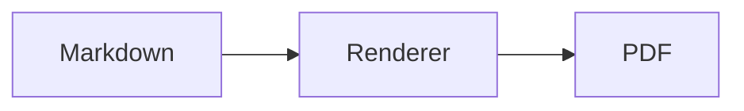
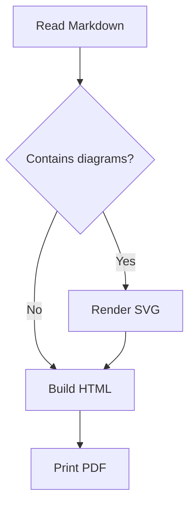
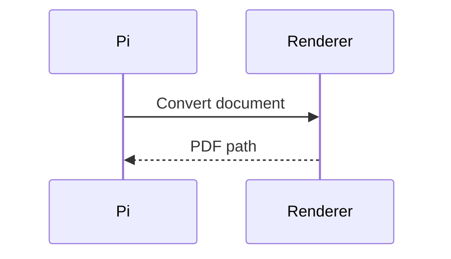
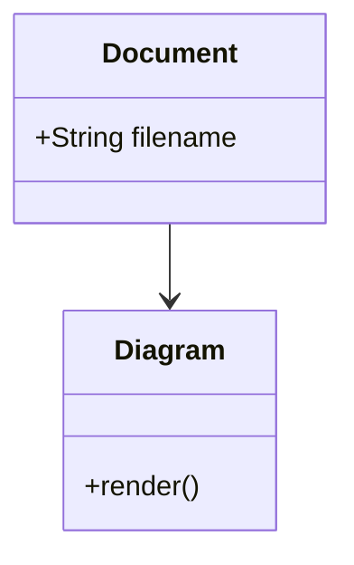
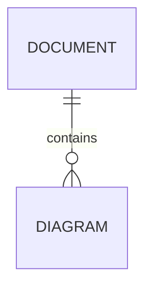
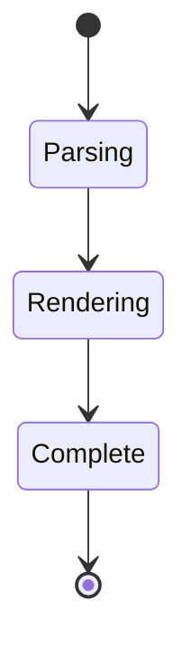
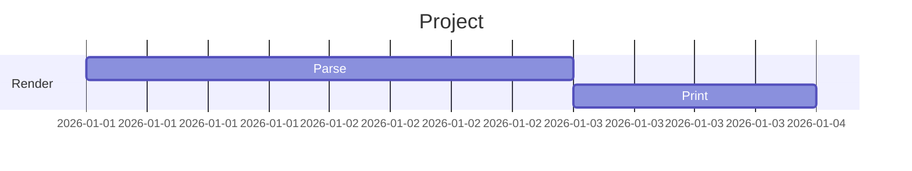
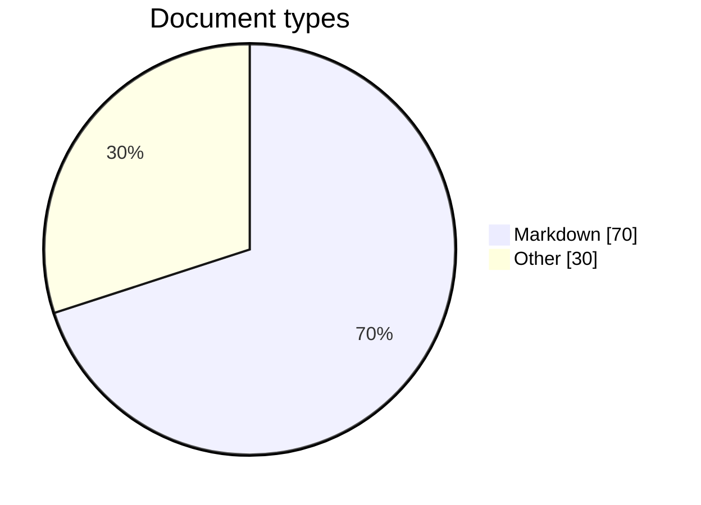
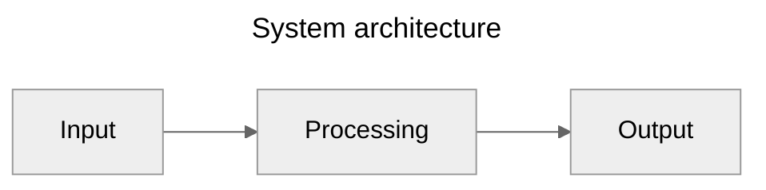
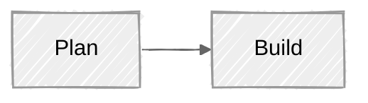

# Mermaid diagrams

[Back to pi-md2pdf](../README.md)

pi-md2pdf renders [Mermaid](https://mermaid.js.org/) diagrams embedded in Markdown into static SVG images for PDF export. Diagrams and LaTeX equations can appear in the same document. No external diagram service, browser extension or additional browser installation is needed.

The package uses Mermaid 12.3.0. It supports the diagram syntax of that engine subject to pi-md2pdf's static rendering and security restrictions; not every Mermaid feature is compatible with PDF output.

## 1. Write a diagram

Use a Markdown fence labeled exactly `mermaid` (lowercase, without additional attributes). The body is the Mermaid definition.

~~~markdown

~~~

Then export the Markdown file in Pi:

~~~text
/md2pdf architecture.md
~~~

Ordinary fences such as `text` preserve diagram source as code. Raw HTML embedding, uppercase fence labels and Pandoc-style fence attributes are not Mermaid embedding mechanisms in pi-md2pdf.

## 2. Diagram examples

The following diagram families are included in the repository's rendering probe: flowchart, sequence, class, entity relationship, state, Gantt and pie. Other families may also render, provided their SVG satisfies the same restrictions. See the [Mermaid syntax documentation](https://mermaid.js.org/intro/) for further diagram types and syntax.

### Flowchart

### Sequence diagram

### Class diagram

### Entity relationship diagram

### State diagram

### Gantt chart

### Pie chart

To include these diagrams in your own Markdown document, copy their definitions together with the surrounding `mermaid` fences.

## 3. Diagram configuration

YAML frontmatter belongs at the start of the diagram definition, **inside** the Mermaid fence. Use it to specify a title and selected visual settings.

~~~markdown

~~~

The renderer validates the frontmatter and only passes approved configuration fields to Mermaid. The following is the accepted configuration surface; acceptance of a value does not guarantee that every diagram family or optional layout renders successfully.

### General options

| Configuration field | Accepted values |
| --- | --- |
| Frontmatter `title` | Plain single-line text, up to 500 characters |
| Frontmatter `displayMode` | `compact` or empty string |
| `config.theme` | `default`, `base`, `neutral`, `dark`, `forest` |
| `config.layout` | `dagre`, `elk` |
| `config.look` | `classic`, `handDrawn`, `neo` |
| `config.handDrawnSeed` | Integer from 0 to 2147483647 |
| `config.wrap` | Boolean |
| `config.htmlLabels` | `false` only |
| `config.themeVariables` | Restricted mapping of simple visual values, such as colors |

For a hand-drawn diagram with a repeatable seed:

~~~markdown

~~~

For custom theme colors, use simple color values rather than custom CSS:

~~~yaml
config:
  theme: base
  themeVariables:
    primaryColor: '#e0f2fe'
    primaryTextColor: '#172554'
~~~

Place this configuration between the frontmatter delimiters inside the diagram fence. Theme variable names and scalar values are restricted; external references and CSS expressions are not allowed.

### Diagram-specific options

Use the corresponding nested mapping under `config`, for example `config.flowchart.nodeSpacing`.

| Mapping | Fields | Accepted values |
| --- | --- | --- |
| `flowchart` | `curve` | basis, linear, cardinal, monotoneX, step, stepAfter, stepBefore, natural |
| `flowchart` | `defaultRenderer` | dagre-wrapper, dagre-d3, elk |
| `flowchart` | `nodeSpacing`, `rankSpacing`, `padding` | Numbers from 0 to 1000 |
| `flowchart` | `useMaxWidth` | Boolean |
| `flowchart` | `htmlLabels` | false only |
| `sequence` | `actorMargin`, `messageMargin`, `diagramMarginX`, `diagramMarginY` | Numbers from 0 to 1000 |
| `sequence` | `useMaxWidth`, `mirrorActors`, `showSequenceNumbers` | Boolean |
| `gantt` | `barHeight`, `barGap`, `topPadding`, `leftPadding`, `rightPadding` | Numbers from 0 to 1000 |
| `gantt` | `useMaxWidth`, `topAxis` | Boolean |
| `gantt` | `displayMode` | compact or empty string |

Mermaid's `%%{init: ...}%%` and `%%{initialize: ...}%%` directives are also recognized, subject to the same validation. Prefer YAML frontmatter in new documents.

## 4. Error handling

Run `/md2pdf settings` to choose the default Mermaid error mode, or set `--mermaid-errors` for a single conversion.

| Mode | Output for a failed diagram | Result |
| --- | --- | --- |
| **placeholder** (default) | Diagnostic with source line number, followed by the original Mermaid code as a literal block | PDF generated; continue with later content |
| **source** | Original Mermaid code as a literal block, without a diagnostic in the PDF | PDF generated; continue with later content |
| **strict** | No fallback | Abort conversion; do not publish a new PDF |

~~~text
/md2pdf report.md --mermaid-errors placeholder
/md2pdf report.md --mermaid-errors source
/md2pdf report.md --mermaid-errors strict
~~~

Both continuing modes report the number, source lines and messages of failed diagrams in the Pi result. Successfully rendered diagrams remain images. The agent tool accepts the corresponding `mermaidErrors` parameter.

For example, a syntax error or a diagram requesting `htmlLabels: true` can be preserved as code while the rest of the document exports in placeholder mode. Strict mode is useful when every diagram must render before you accept a PDF.

The modes do not suppress infrastructure errors: browser or module-loading failures, cancellation, timeouts, filesystem errors and resource limits still abort conversion.

## 5. Static rendering and security

The converter uses the installed Mermaid modules in a temporary, isolated JavaScript-enabled Chromium context. It supplies only the diagram source to this renderer, validates the returned SVG, embeds the SVG as an image and closes the context. The final PDF page is JavaScript-disabled and external network requests are blocked.

Restrictions:

- HTML labels are disabled, including `foreignObject` elements. Both `htmlLabels: false` and `flowchart.htmlLabels: false` are accepted. Enabling either is rejected.
- Interactive clicks, script execution, animation and external SVG resources are not supported.
- Security-level overrides, custom CSS and non-allowlisted configuration are rejected.
- YAML aliases and duplicate keys are not accepted.
- A document may contain up to 50 Mermaid diagrams. Each definition is limited to 50,000 characters; each generated SVG to 5 MiB, and the combined SVG output to 30 MiB. Mermaid is configured with a 500-edge limit.

These restrictions apply in every error mode. Rejected SVG is never embedded as a fallback.

## 6. Print layout and troubleshooting

- Prefer concise labels and simple shapes. Use `flowchart TD` for tall layouts and `flowchart LR` for wider layouts, choosing what fits the page.
- The renderer scales SVG images to the printable area and attempts to keep each diagram on a single page. Large diagrams may become too small to read; split them into smaller diagrams when necessary.
- Prefer light themes such as `default` or `neutral` for printed documents.
- If a configuration option is rejected, remove it or replace it with an accepted value.
- If a complex diagram fails, export it alone with strict mode to isolate the error. Diagram syntax that works in another Mermaid viewer may still produce SVG that is incompatible with this renderer.
- Inspect the generated PDF for text readability, clipping and pagination. Successful conversion does not certify visual quality.

The [Mermaid rendering probe](https://github.com/civcode/pi-md2pdf/blob/main/tests/fixtures/mermaidtest.md) contains representative diagrams, configured frontmatter and an equation in the same file.
