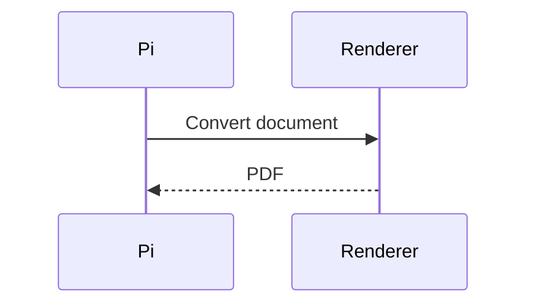
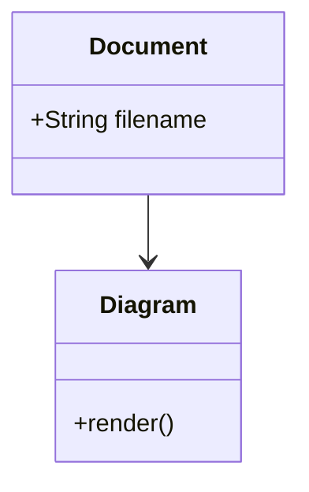
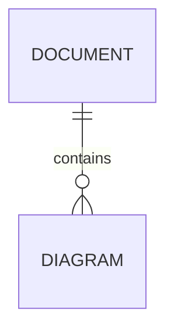
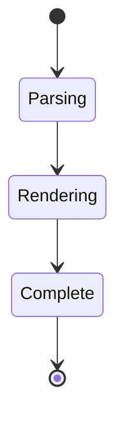
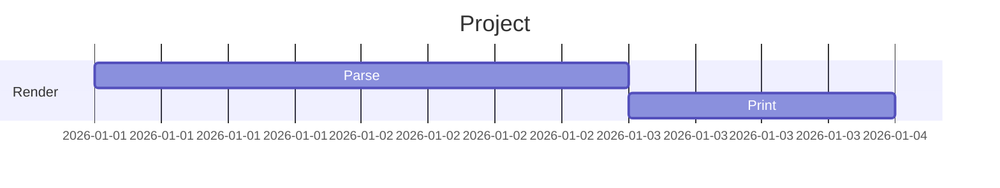
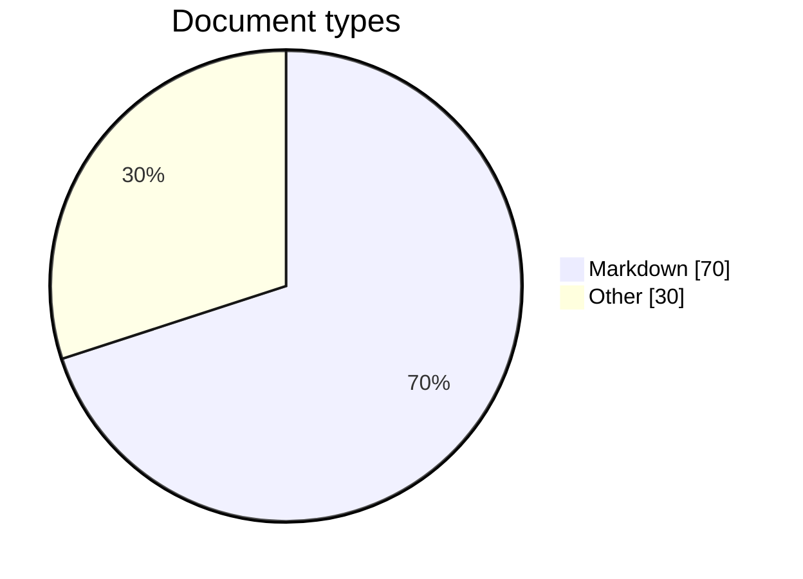

# Mermaid rendering probe

Math remains supported: $E = mc^2$.

## Flowchart


## Sequence



## Class diagram



## Entity relationship



## State



## Gantt



## Pie



## Ordinary code remains literal

```text
flowchart LR
  A --> B
```
